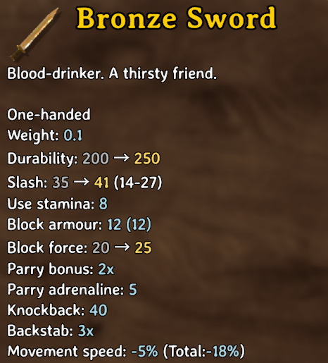
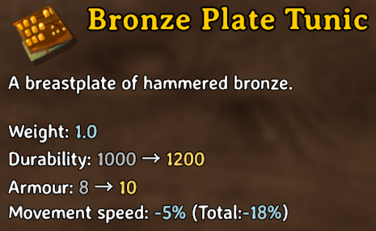
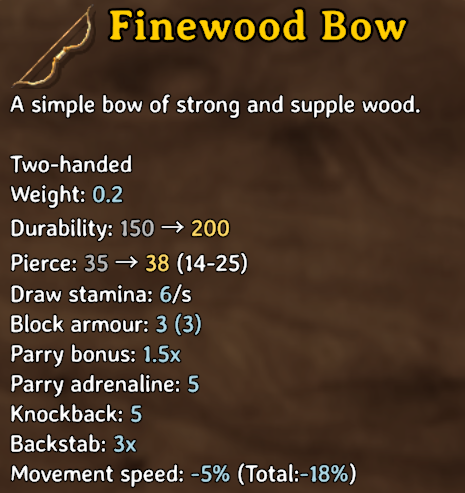
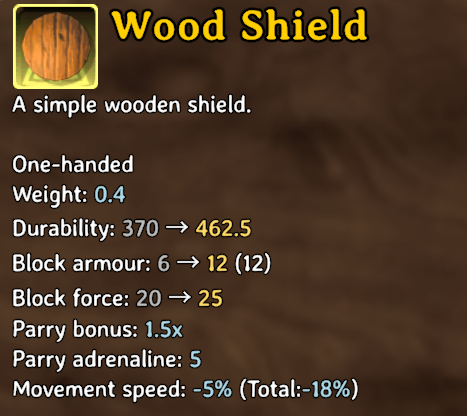

# Simple Item Upgrade Preview


**Know what you’re getting before you upgrade.**

See your item’s current stats alongside its next upgrade values, right inside Valheim’s existing Upgrade panel. Compare improvements before spending your materials, with no extra windows, hotkeys, or configuration.

Current values appear in grey and upgraded values in gold. Only changed supported stats receive a comparison.



## Features

- Preview changes to damage, armour, maximum durability, and supported blocking stats.
- Uses the existing Upgrade panel and the selected item’s tooltips.
- Client-side BepInEx mod; no server installation required.
- Does not change crafting costs, item stats, upgrade results, or save data.

## Usage

Open a crafting station, select **Upgrade**, and choose an item. Supported changed stats show **current → upgraded** values.

Durability compares maximum durability, not current wear. Damage ranges in parentheses describe the upgraded item’s skill-dependent damage range.

## Screenshots

Captured in a modded playthrough; item balance values may differ in your game.

| Armour | Bow | Shield |
| --- | --- | --- |
|  |  |  |

## Installation

Requires Valheim and BepInEx 5. Build the DLL using the instructions below, then copy `dist/SimpleItemUpgradePreview.dll` into a dedicated folder under your active profile’s `BepInEx/plugins`. Restart the game.

If replacing the earlier locally named `SimpleUpgradePreview.dll`, remove that previous DLL first. Both use the same plugin identifier: `local.che.simpleupgradepreview`.

To uninstall, remove this mod’s DLL. Do not manually register it in your mod manager’s `mods.yml`; use the packaged ZIP for mod-manager imports.

## Build and test

On Windows, use the .NET Framework C# compiler and references from your own Valheim and BepInEx installations. No game or third-party DLLs are included.

```powershell
.\build.ps1 -GameManagedDirectory 'D:\Games\Valheim\valheim_Data\Managed' -BepInExCoreDirectory 'D:\ModProfile\BepInEx\core'
.\test.ps1
```

Both scripts accept an optional `-Compiler` path. Build output goes into `dist/`.

## Compatibility and validation

Built against the installed Valheim and BepInEx libraries on October 18, 2026. Four in-game screenshots demonstrate weapon, armour, bow, and shield comparisons. Fourteen automated text-comparison checks cover formatting and edge cases.

Other mods can influence tooltip values. UI replacements that replace the normal Upgrade panel may not work. Epic Loot patches were inspected during development, but comprehensive enchanted-item and Forge of Potential behavior has not been verified. This mod does not change refinement odds or outcomes.

On an unexpected preview error, the mod logs a warning and disables its comparison feature for that session.

## Reporting issues

Include your Valheim and BepInEx versions, relevant UI or item mods, the selected item and quality, a screenshot, and relevant log excerpts. Remove personal information before sharing logs.

